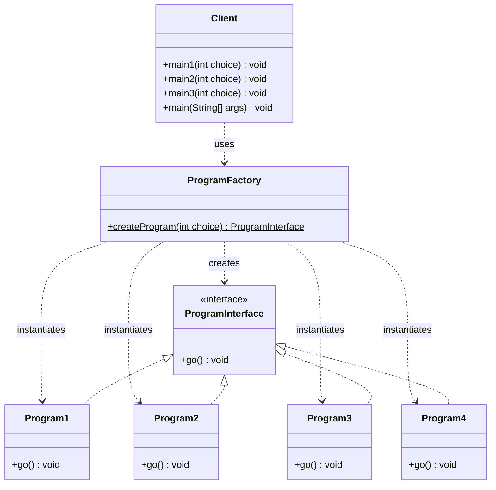

## Exercise 1: Singleton Design Pattern

### Java Code:
```java
public class Database {  
    private String name;  
    private static Database instance;  
  
    // Private constructor for the Singleton design pattern  
    private Database(String name) {  
        this.name = name;  
    }  
  
    // Returns the unique instance of Database  
    public static Database getInstance(String name) {  
        if (instance == null) {  
            instance = new Database(name);  
        }  
        return instance;  
    }  
  
    public void getConnection() {  
        System.out.println("You are connected to the database: " + this.name);  
    }  
  
    public static void main(String[] args) {  
        // Attempt to create two databases with different names  
        Database database1 = Database.getInstance("Database1");  
        Database database2 = Database.getInstance("Database2");  
  
        database1.getConnection();  
        database2.getConnection();  
  
        // Verify that both references point to the same instance  
        System.out.println("Same instance: " + (database1 == database2));  
    }  
}
```

## Output screenshot
![[Design Patterns Lab-1793275434264.webp]]


## Exercise 2: Factory Design Pattern

### 1. Naive Solution
We incorporate the 3 programs calls in the main, and we pass an integer as a parameter in the main function to choose which program to run

**Problem**: You would repeat this conditional logic in `main1()`, `main2()` and `main3()`. Adding another program would require modifying multiple methods.
Also we have method overloading, we have two `main` methods in the program.
#### Code:
```java
public class Client {  
    public Client(){};  
    public static void main(int choice) {  
        if (choice == 1) {  
            Program1 p = new Program1();  
            p.go();  
        } else if (choice == 2) {  
            Program2 p = new Program2();  
            p.go();  
        } else if (choice == 3) {  
            Program3 p = new Program3();  
            p.go();  
        }  
    }  
    public static void main (String[] args) {  
        Client client = new Client();  
        // Passing the choice argument  
        client.main(1);  
        client.main(2);  
        client.main(3);  
    }  
}
```

#### Output

![[Design Patterns Lab-1793276536925.webp]]

- The `Client` is directly responsible for creating `Program1`, `Program2`, and `Program3`.
    
- Adding a new program requires modifying the `Client` class.
    
- The client is strongly coupled to the concrete program classes.
    
- The solution becomes harder to maintain as the number of programs increases.

### 2. Applying The Factory Pattern

#### Class Diagram 


#### Code:
ProgramInterface.java
```java
public interface ProgramInterface {
    void go();
}
```

Program1.java
```java
public class Program1 implements ProgramInterface {
    @Override
    public void go() {
        System.out.println("Je suis le traitement 1");
    }
}
```

Program2.java
```java
public class Program2 implements ProgramInterface {
    @Override
    public void go() {
        System.out.println("Je suis le traitement 2");
    }
}
```

Program3.java
```java
public class Program3 implements ProgramInterface {
    @Override
    public void go() {
        System.out.println("Je suis le traitement 3");
    }
}
```

Program4.java
```java
public class Program4 implements ProgramInterface {
    @Override
    public void go() {
        System.out.println("Je suis le traitement 4");
    }
}
```

ProgamFactory.java
```java
public class ProgramFactory {

    public static ProgramInterface createProgram(int choice) {
        switch (choice) {
            case 1:
                return new Program1();
            case 2:
                return new Program2();
            case 3:
                return new Program3();
            case 4:
                return new Program4();
            default:
                throw new IllegalArgumentException("Invalid choice");
        }
    }
}
```

Client.java
```java
public class Client {

    public static void main1(int choice) {
        System.out.println("I am main1");
        ProgramInterface p = ProgramFactory.createProgram(choice);
        p.go();
    }

    public static void main2(int choice) {
        System.out.println("I am main2");
        ProgramInterface p = ProgramFactory.createProgram(choice);
        p.go();
    }

    public static void main3(int choice) {
        System.out.println("I am main3");
        ProgramInterface p = ProgramFactory.createProgram(choice);
        p.go();
    }

    public static void main(String[] args) {
        main1(1);
        main2(2);
        main3(4);
    }
}
```

#### Output


#### Observations
- **Separation of responsibilities**
The creation of program objects is now handled by `ProgramFactory`. The `Client` only requests a program and executes its `go()` method.

- **Reduced coupling**
The `Client` no longer depends directly on `Program1`, `Program2`, or `Program3`. Instead, it uses the common `ProgramInterface`.

- **Code reusability**
The same factory method can be used by `main1()`, `main2()`, and `main3()`, avoiding duplicated object creation logic.

- **Adding Program4**
Adding `Program4` was simple. We only needed to create a new class implementing `ProgramInterface` and add another case to `ProgramFactory`. The `Client` implementation did not need to be modified.

- **Maintainability**
The Factory pattern makes the application easier to maintain because object creation is centralized in one place.

## 4. Comparison

|Criteria|Naive solution|Factory solution|
|---|---|---|
|Object creation|Inside Client|Inside Factory|
|Coupling|Strong|Reduced|
|Code duplication|Potentially repeated|Centralized|
|Adding Program4|Modify Client|Modify Factory|
|Maintainability|Lower|Higher|
