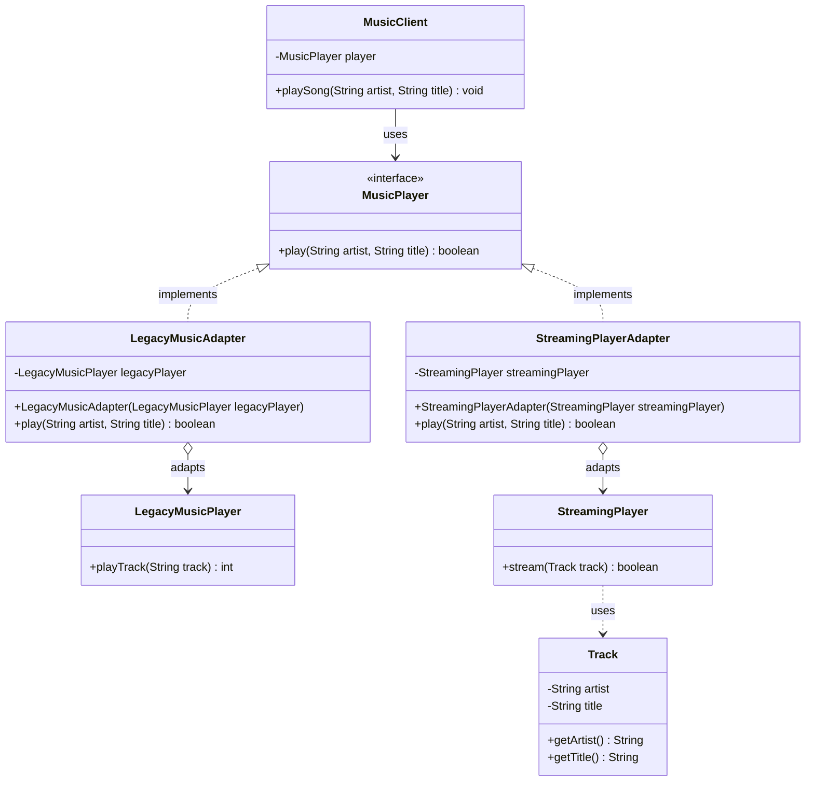
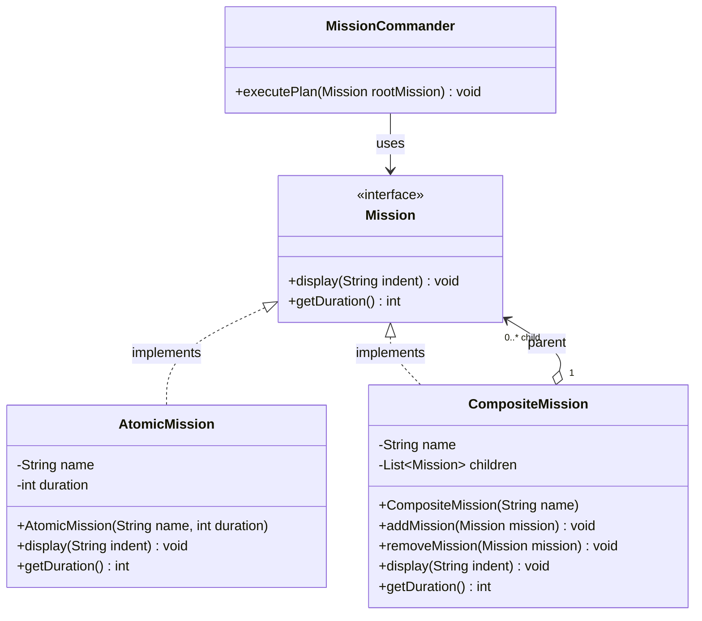

AREZDI Yazid
SQUALLI HOUSSAINI Aya
# Level 0: Pattern Detective

1. Adapter
2. Composite
3. Neither, it's the singleton design pattern
4. Composite

# Level 1: Music Library Rescue - Adapter

## 1. UML Class Diagram (with the modification for the `Track` class )



## 2. Implementation in Java

```java
public class Main {

    public static class Track {
        private final String artist;
        private final String title;

        public Track(String artist, String title) {
            this.artist = artist;
            this.title = title;
        }

        public String getArtist() {
            return artist;
        }

        public String getTitle() {
            return title;
        }
    }

    public interface MusicPlayer {
        boolean play(String artist, String title);
    }

    public static class LegacyMusicPlayer {
        public int playTrack(String track) {
            if (track == null || track.trim().isEmpty()) {
                return 0;
            }
            System.out.println("[LEGACY PLAYER] " + track);
            return 1;
        }
    }

    public static class MusicAdapter implements MusicPlayer {
        private final LegacyMusicPlayer legacyMusicPlayer;

        public MusicAdapter(LegacyMusicPlayer legacyMusicPlayer) {
            this.legacyMusicPlayer = legacyMusicPlayer;
        }

        @Override
        public boolean play(String artist, String title) {
            if (artist == null || title == null || artist.trim().isEmpty() || title.trim().isEmpty()) {
                return false;
            }
            String formattedTrack = artist.trim() + " " + title.trim();
            return legacyMusicPlayer.playTrack(formattedTrack) == 1;
        }
    }

    public static class StreamingPlayer {
        public boolean stream(Track track) {
            if (track == null || track.getArtist() == null || track.getTitle() == null
                    || track.getArtist().trim().isEmpty() || track.getTitle().trim().isEmpty()) {
                return false;
            }
            System.out.println("[STREAMING PLAYER] Streaming \"" + track.getTitle().trim()
                    + "\" by " + track.getArtist().trim());
            return true;
        }
    }

    public static class StreamingPlayerAdapter implements MusicPlayer {
        private final StreamingPlayer streamingPlayer;

        public StreamingPlayerAdapter(StreamingPlayer streamingPlayer) {
            this.streamingPlayer = streamingPlayer;
        }

        @Override
        public boolean play(String artist, String title) {
            Track track = new Track(artist, title);
            return streamingPlayer.stream(track);
        }
    }

    private static void playSong(MusicPlayer player, String artist, String title) {
        boolean success = player.play(artist, title);
        System.out.println("Playback success: " + success);
    }

    public static void main(String[] args) {
        MusicPlayer legacyAdapter = new MusicAdapter(new LegacyMusicPlayer());
        MusicPlayer streamingAdapter = new StreamingPlayerAdapter(new StreamingPlayer());

        System.out.println("--- Testing Legacy Adapter ---");
        playSong(legacyAdapter, "Coldplay", "Yellow");
        playSong(legacyAdapter, " ", "Yellow");

        System.out.println("--- Testing Streaming Adapter ---");
        playSong(streamingAdapter, "Coldplay", "Yellow");
        playSong(streamingAdapter, "Coldplay", "");
    }
}
```

## 3. Testing the implementation
![[TP Design Patterns -  Robot Battle Arena-1795512987127.webp]]

# Level 2: Mission Planner - Composite

## 1. UML Class Diagram


## 2. Implementation in Java
```java
import java.util.*;

public class Main {

    public interface Mission {
        void display(String indent);
        int getDuration();
    }

    public static class AtomicMission implements Mission {
        private String name;
        private int duration;

        public AtomicMission(String name, int duration) {
            this.name = name;
            this.duration = duration;
        }

        public void display(String indent) {
            System.out.println(indent + name + ": " + duration);
        }

        public int getDuration() {
            return duration;
        }
    }

    public static class CompositeMission implements Mission {
        private final String name;
        private final List<Mission> children = new ArrayList<>();

        public CompositeMission(String name) {
            this.name = name;
        }

        public void add(Mission mission) {
            children.add(mission);
        }

        public void remove(Mission mission) {
            children.remove(mission);
        }

        @Override
        public void display(String indent) {
            System.out.println(indent + name);

            for (Mission child : children) {
                child.display(indent + "  ");
            }
        }

        @Override
        public int getDuration() {
            int total = 0;

            for (Mission child : children) {
                total += child.getDuration();
            }

            return total;
        }
    }

    public static void main(String[] args) {

        CompositeMission preparation =
                new CompositeMission("Preparation");

        preparation.add(new AtomicMission("Deploy", 8));
        preparation.add(new AtomicMission("Check fuel", 5));
        preparation.add(new AtomicMission("Load robots", 10));

        CompositeMission launchOperation =
                new CompositeMission("Launch Operation");

        launchOperation.add(preparation);

        launchOperation.display("");

        System.out.println("Total duration: "
                + launchOperation.getDuration() + " minutes");
    }
}
```

## 3. Testing the implementation

![[TP Design Patterns -  Robot Battle Arena-1795514360624.webp]]


# Level 3: Robot Battle Arena - Adapter + Composite

## Parts A, B, C, D & E: Implementation in Java

*(Includes the **Power Budget** upgrade from Part E.)*

```java
import java.util.ArrayList;  
import java.util.List;  
  
public class Main {  
    // Part A: Common interface  
    public interface BattleUnit {  
        void attack();  
        int getPower();  
    }  
    public static class ModernRobot implements BattleUnit {  
        private final String name;  
        private final int power;  
        private final String attackMessage;  
  
        public ModernRobot(String name, int power, String attackMessage) {  
            if (power <= 0) {  
                System.out.println("Power must be positive.");  
            }  
            this.name = name;  
            this.power = power;  
            this.attackMessage = attackMessage;  
        }  
        @Override  
        public void attack() {  
            System.out.println(name + " " + attackMessage);  
        }  
        @Override  
        public int getPower() {  
            return power;  
        }  
    }  
    // Part B: Adapter pattern  
    public static class OldRobot {  
        private final String model;  
        private final int laserPower;  
        public OldRobot(String model, int laserPower) {  
            this.model = model;  
            this.laserPower = laserPower;  
        }  
        public void fireLaser() {  
            System.out.println(model + " fires a laser!");  
        }  
        public int getLaserPower() {  
            return laserPower;  
        }  
    }  
    public static class OldRobotAdapter implements BattleUnit {  
        private final OldRobot oldRobot;  
        public OldRobotAdapter(OldRobot oldRobot) {  
            this.oldRobot = oldRobot;  
        }  
        @Override  
        public void attack() {  
            oldRobot.fireLaser();  
        }  
        @Override  
        public int getPower() {  
            return oldRobot.getLaserPower();  
        }  
    }  
    // Parts C and E: Composite pattern and power budget  
    public static class RobotSquad implements BattleUnit {  
        private final String name;  
        private final int maxPowerBudget;  
        private final List<BattleUnit> children;  
  
        public RobotSquad(String name) {  
            this(name, Integer.MAX_VALUE);  
        }  
        public RobotSquad(String name, int maxPowerBudget) {  
            this.name = name;  
            this.maxPowerBudget = maxPowerBudget;  
            this.children = new ArrayList<>();  
        }  
        public boolean add(BattleUnit unit) {  
            if (unit == null || unit == this) {  
                return false;  
            }  
  
            if (getPower() + (long) unit.getPower() > maxPowerBudget) {  
                return false;  
            }  
            children.add(unit);  
            return true;  
        }  
        public void remove(BattleUnit unit) {  
            children.remove(unit);  
        }  
        @Override  
        public void attack() {  
            for (BattleUnit child : children) {  
                child.attack();  
            }  
        }  
        @Override  
        public int getPower() {  
            int total = 0;  
  
            for (BattleUnit child : children) {  
                total += child.getPower();  
            }  
            return total;  
        }  
    }  
    // Part D: Battle simulation  
    public static void main(String[] args) {  
    RobotSquad redVanguard = new RobotSquad("Red Vanguard");  
    redVanguard.add(new ModernRobot(  
            "Saber", 25, "unleashes excalibur"));  
    redVanguard.add(new OldRobotAdapter(  
            new OldRobot("Himeko", 20)));  
    RobotSquad redArmy = new RobotSquad("Red Army", 100);  
    redArmy.add(redVanguard);  
    redArmy.add(new ModernRobot(  
            "Lancer", 35, "Gae bolg"));  
    redArmy.add(new ModernRobot(  
            "archer", 30, "GATE OF BABYLON"));  
    RobotSquad blueRecon = new RobotSquad("Blue Recon");  
    blueRecon.add(new ModernRobot(  
            "Assassin", 20, "dies for the plot"));  
    blueRecon.add(new OldRobotAdapter(  
            new OldRobot("Emiya", 15)));  
    RobotSquad blueArmy = new RobotSquad("Blue Army", 100);  
    blueArmy.add(blueRecon);  
    blueArmy.add(new ModernRobot(  
            "rider", 30, "Ionioi Hetairoi"));  
    redArmy.attack();  
    blueArmy.attack();  
    int red = redArmy.getPower();  
    int blue = blueArmy.getPower();  
    System.out.println("Red Army Total Power: " + red);  
    System.out.println("Blue Army Total Power: " + blue);  
    if (red > blue) {  
        System.out.println("Winner: Red Army!");  
    } else if (blue > red) {  
        System.out.println("Winner: Blue Army!");  
    } else {  
        System.out.println("Result: Draw!"); 
        }  
    }  
}
```

## Testing the Implementation
![[TP Design Patterns -  Robot Battle Arena-1795515534858.webp]]

## Checkpoint

The battle engine cannot (and should not) distinguish between a legacy robot, a modern robot, and a squad. Every participant is manipulated exclusively through the `BattleUnit` interface (`attack()` and `getPower()`):
* **Adapter Pattern (`OldRobotAdapter`)**: Bridges the incompatible `OldRobot` interface (`fireLaser()`, `getLaserPower()`) to `BattleUnit` without modifying `OldRobot`.
* **Composite Pattern (`RobotSquad`)**: Treats individual `BattleUnit` leaves (`ModernRobot`, `OldRobotAdapter`) and nested `RobotSquad` composites uniformly through recursive delegation.

## Final Showcase Answers

1. **Where is the Target interface? Where is the Adaptee? Which class wraps it?**
   * **Target interface:** `BattleUnit`
   * **Adaptee:** `OldRobot`
   * **Adapter (wrapper):** `OldRobotAdapter`

2. **Which class is the Leaf? Which class is the Composite?**
   * **Leaves:** `ModernRobot` and `OldRobotAdapter` (representing single battle units with no children)
   * **Composite:** `RobotSquad` (holds a `List<BattleUnit>` of children and delegates operations recursively)

3. **What would change if you added a new legacy robot type with a different API?**
   * Only a **new Adapter class** implementing `BattleUnit` and wrapping the new legacy robot would be added. Neither `BattleUnit`, `ModernRobot`, `OldRobotAdapter`, `RobotSquad`, nor the battle simulation logic would need any modification (adhering to the Open/Closed Principle).

4. **What would change if you added another level of nested squads?**
   * **Nothing in the class structure or battle engine would change.** Because `RobotSquad` implements `BattleUnit` and stores a `List<BattleUnit>`, arbitrary nesting depth is already supported automatically via recursion.

5. **What part of the solution depends on polymorphism, rather than `instanceof` checks?**
   * The core battle commands (`attack()` and `getPower()`) in `RobotSquad` and `main()` rely entirely on **polymorphism**: calling `unit.attack()` or `unit.getPower()` on any `BattleUnit` reference dynamically dispatches to `ModernRobot`, `OldRobotAdapter`, or `RobotSquad` at runtime without needing `instanceof` type checks.